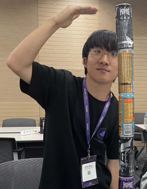

# 안녕하세요,

Hello Hola こんにちは Bonjour Ciao

 

## 무엇이든 마지않는 권도한입니다.

[학부과정 @ 연세대학교 미래캠퍼스 소프트웨어학부](https://sw.yonsei.ac.kr/)

> 앞말이 뜻하는 행동을 진심으로 함을 강조하여 나타내는 말. 
> '마지아니하다' 표준국어대사전

 

## I am Do-han Kwon,
someone who pours his whole heart into everything.

[Undergraduate @ Department of Software, Yonsei University Mirae Campus](https://sw.yonsei.ac.kr/?_l=en)

 

### I love to ...

- Develop & Design Web Sites.
- Develop Operating Systems.
- Design Electronic Circuits.
- Tinker with FPGAs, SoCs, etc.
- Set up and tune servers.
- Write down & Share my experiences.

 

### I speak (and program) in ...

- Korean. English.
- HTML, CSS, JavaScript.
- NodeJS. TypeScript. React. ExpressJS.
- SQL, RDBMS.
- C-like (C/C++).
- Assembly Language.
- Python.
- Makefile. (not CMAKE)
- Git.
- Docker.

 

### Check out ...

- [~/projects/](/projects)
- [~/journals/](/journals)
- [~/papers/](/papers)

 

---

