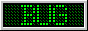

# 88X31px 버튼

여러분은 혹시 [88X31px 버튼](https://en.wikipedia.org/wiki/Web_badge)을 아십니까?

 이런거요!

다른 말로는 **웹 [배지](https://ko.dict.naver.com/#/entry/koko/ec9d3a28d22a4fa8bdf3466cd9980ef5)** 라고 하더라구요.

 

1990년대 말 부터 개인 홈페이지에 88X31px 크기의 이런 버튼들을 다는 것이 유행이였데요.

저는 이번에 처음 알았는데... 역시 어른들 재밌는거 하셨네...

무튼 제가 [무려 배지 이미지 86,882개](https://github.com/transicle/88x31) 중에서 쓸만한 것들만 이 사이트에 반영해 봤어요!

 

같이 구경해요!

---

